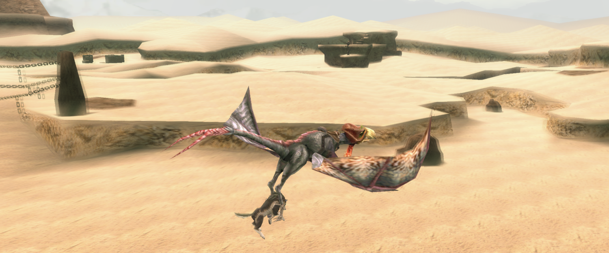
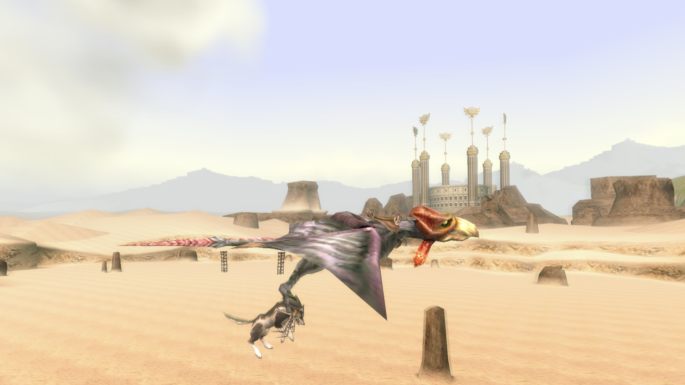
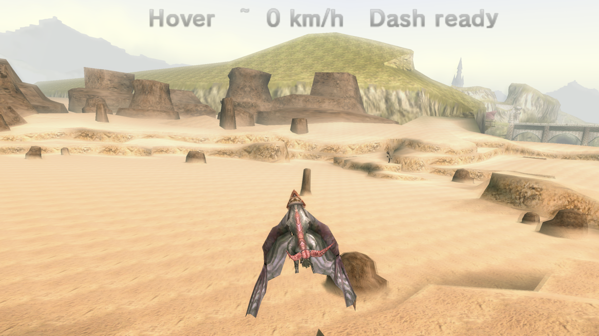
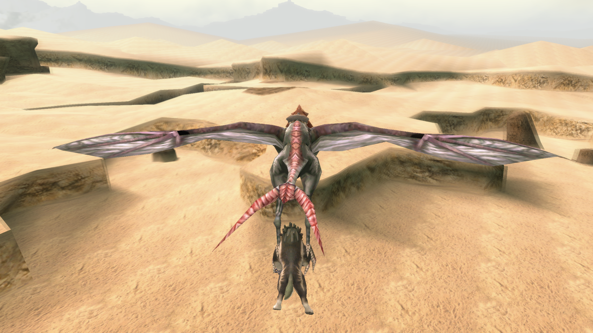
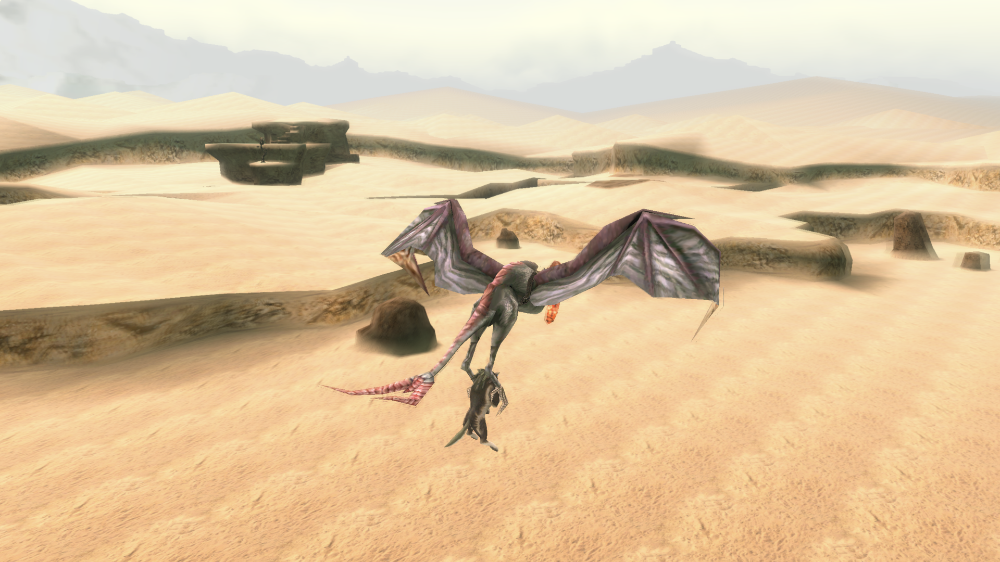
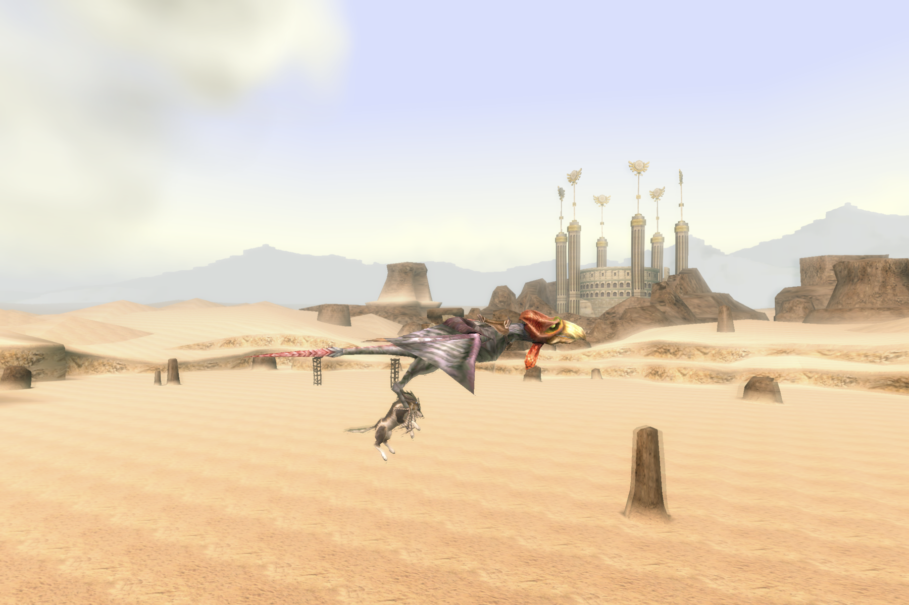
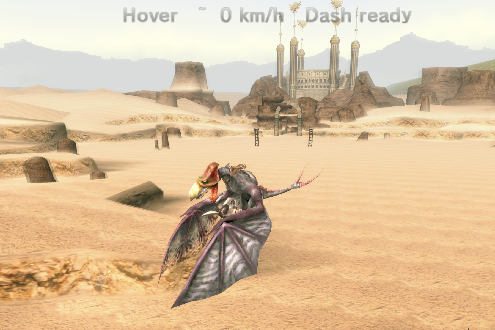
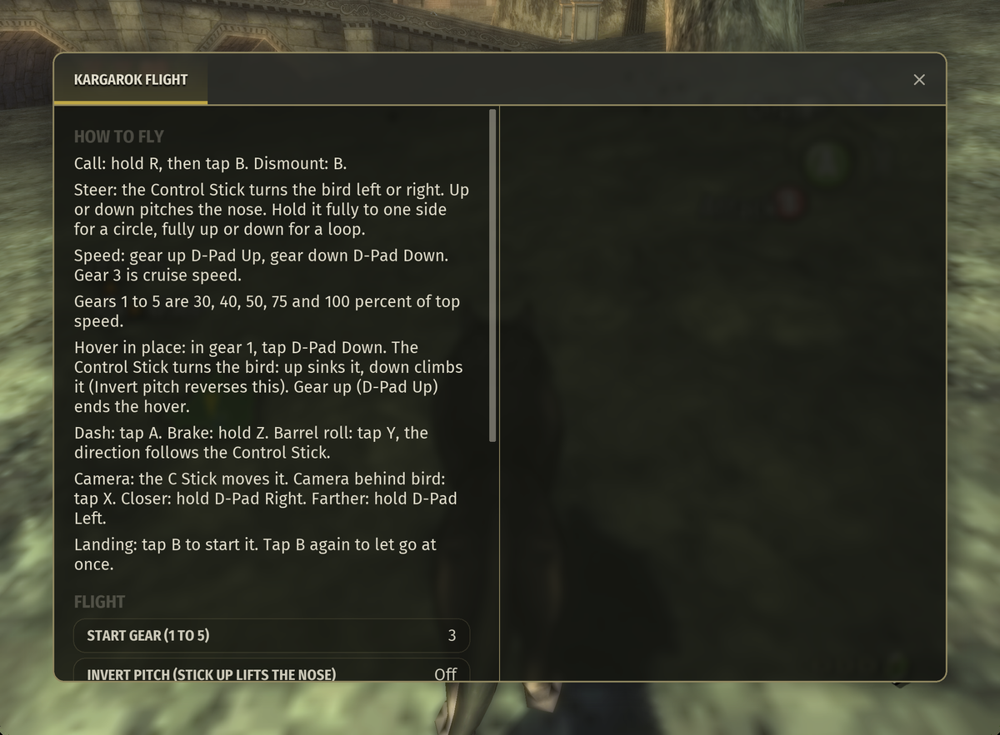

# Kargarok Flight



Fly anytime, anywhere on the friendly Kargarok! Call your ride and it swoops down, grabs Wolf Link in its talons and carries you high above Hyrule. Glide across Hyrule Field toward the castle, race through the canyon into Kakariko, circle the smoke of Death Mountain or sweep over the Gerudo Desert – the whole world is yours to explore from the sky. Speed up and slow down smoothly, hang perfectly still in the air to take in the view, burst ahead with a dash, or throw in loops and barrel rolls just for fun. Hold R and tap B to call the bird, tap B to land. Speed, camera and every flight button can be adjusted in the Mods panel.

Kargarok Flight is a mod for Dusklight 2.0.3, a reverse-engineered reimplementation of *The Legend of Zelda: Twilight Princess*.

| | |
|---|---|
| Version | 2.4.2 |
| Platforms | One `kargarok_flight.dusk` for Windows (x64, ARM64), macOS (Apple Silicon, Intel), Linux (x86_64, aarch64), iOS and Android. Tested in the game on macOS (Apple Silicon) and Windows (x64). The other platforms are built, but not tested in the game. |
| Dusklight | 2.0.3 |
| Tested | Disc ID `RZDP` (PAL). The mod writes a `region:` line to the log at start. `GZ2P`, `GZ2E` and `GZ2J` are not tested. |

The game and the Mods panel are in English. Names in quotation marks are the labels as they appear in the game. Log lines are German, because the mod writes them in German. This guide quotes them unchanged.

## Quick start

The basic flight takes about 30 seconds.

1. **Call the bird.** Hold R (R2 on PlayStation), then tap B (Circle). The bird appears above Link, and the ride starts.
2. **Steer.** The Control Stick turns the bird left or right. By default, stick up tips the nose down, like a plane. Hold the stick fully to one side for a circle, or fully up or down for a loop.
3. **Change your speed.** Hold R (R2 on PlayStation) to speed up, and hold L (L2) to slow down. The speed changes smoothly while you hold, from standstill to top speed in about 3 seconds. Let go, and the bird keeps the speed it has. D-Pad Up and D-Pad Down add or take away 20 percent per tap. You start at 50 percent, the cruise speed.
4. **Hover in place.** Hold L until the bird stops in the air. It then hovers by itself, without a further tap. Turn it with the Control Stick. Push the stick up to sink, or down to climb. To fly on, hold R, tap D-Pad Up, or tap A (Dash). See [Hover in place](#hover-in-place).
5. **Dash, brake, barrel roll.** Tap A (Cross) to dash. Hold Z (R1) to brake. Tap Y (Triangle) for a barrel roll.
6. **Land.** Tap B (Circle). The bird slows down and sinks. With no ground or water below, Link lets go at once. Tap B again to let Link go at once.

Tip: turn on **Show speed and hover** in the Mods panel. The screen then shows the speed in percent (or Hover when the bird stands still), the approximate speed and the dash status.

Times in this guide are in ticks and seconds. A tick is one controller poll by the game, and 30 ticks make one second. See [Time and units](#time-and-units).

## Screenshots

| | |
|---|---|
|  |  |
| Over the Gerudo Desert toward the Arbiter's Grounds, with Wolf Link in the talons. | Hovering in place, with "Show speed and hover" turned on. |
|  |  |
| The camera behind the bird. | A dash over the dunes. |

## Controls

The table shows the default buttons on a GameCube controller and on a DualSense. Dusklight decides which controller button or key sends a GameCube button. See [Changing the flight buttons](#changing-the-flight-buttons).

| Action | GameCube (default) | PlayStation (DualSense) | Setting key |
|---|---|---|---|
| Call the bird: hold | R | R2 (press firmly) | `bind_ruf_halten` |
| Call the bird: then tap | B | Circle | `bind_ruf_tipp` |
| Dismount (start landing) | B | Circle | `bind_absteigen` |
| Dash | A | Cross | `bind_dash` |
| Faster (hold): speed up | R | R2 | `bind_schneller` |
| Slower (hold): slow down, to a hover at 0 percent | L | L2 | `bind_langsamer` |
| Speed up, one step of 20 percent (also ends a hover) | D-Pad Up | D-Pad Up | `bind_gang_hoch` |
| Speed down, one step of 20 percent (to a hover at 0 percent) | D-Pad Down | D-Pad Down | `bind_gang_runter` |
| Brake (hold) | Z | R1 | `bind_bremse` |
| Barrel roll | Y | Triangle | `bind_fassrolle` |
| Camera behind bird | X | Square | `bind_kamera_hinten` |
| Camera closer (hold) | D-Pad Right | D-Pad Right | `bind_kamera_naeher` |
| Camera farther (hold) | D-Pad Left | D-Pad Left | `bind_kamera_weiter` |
| Steer, nose and loop | Control Stick (fixed) | Left stick (fixed) | none |
| Camera turn and tilt | C Stick (fixed) | Right stick (fixed) | none |
| Pause | Start (fixed) | Options | none |
| Open the Dusklight menu | BACK, or R and Start together | Create, or R2 and Options together | none |

Notes:

- The Mods panel and the Flight buttons window use GameCube names. On a DualSense, R is R2, L is L2 and Z is R1.
- By default, R is both Call: hold and Faster (hold). The call uses R before the ride starts, and during the ride R speeds up. If you still hold R when the ride starts, the bird waits until you let go, and then R speeds up.
- R2 and Options together open the Dusklight menu. R2 is the call button, so do not press Options while you hold R2 during a ride.
- On a DualSense, Dusklight shows BACK as "Create". Whether the label printed on your controller matches is not tested.
- On the keyboard, F1 opens the Dusklight menu. Whether F1 does this on your Mac keyboard is not tested.
- Dusklight's "Custom Action Bindings" replace the default control of the action they are bound to. Dusklight warns that such a button should not be used anywhere else. Whether a flight button and a Custom Action Binding on the same button both respond is not tested.
- Other controllers are not tested.

## How to fly

### Calling the bird

- Hold R and tap B (on PlayStation: hold R2 and tap Circle). The bird appears directly above Link, and the ride starts.
- If Link is human, he first turns into Wolf Link. With "Ride as Human Link" on, Link rides as a human instead (experimental). Link hangs from a grip under the bird instead of sitting on its back. The bird flies the same way as with Wolf Link.
- After you land, Link turns back into a human if he was human before and the event flag M_077 (transformation unlocked) is not set. If M_077 is set, Link stays Wolf Link.
- A call can be refused, for example during a conversation, in water, while Link takes damage, or while the memory card is being written. Then B goes back to the game, and the log gives the reason. See [Troubleshooting](#troubleshooting).
- If the ride does not start within 300 ticks (10 s) of the call, the mod removes the bird. An event before the ride start removes the called bird at once.
- If the bird from your last ride is still flying away, a new call removes it. The new bird appears as soon as the old one is gone. If the call waits longer than 300 ticks (10 s), the mod gives up, and B goes back to the game.



### Steering

- The Control Stick (left stick on PlayStation) steers. At full deflection at cruise speed (50 percent), the bird turns once around in 128 ticks (about 4 s). Held fully up or down, it flies a loop in about 103 ticks (just over 3 s) at cruise speed. The turn gets quicker with speed: at top speed a full turn takes 64 ticks, and at 30 percent or less about 213 ticks. A smaller deflection flies more slowly. With no stick input, the bird does not turn.
- When the stick is within 0.10 of the center, up or down, the nose levels out slowly.
- By default, stick up tips the nose down, like a plane. With "Invert pitch (stick up lifts the nose)" on, stick up lifts the nose.

### Speed

Top speed is twice the value of `cruise_speed`. The speed is shown as a percentage of top speed. Cruise speed is 50 percent.

- **Speed up and slow down with R and L.** Hold R (R2 on PlayStation) to speed up, and hold L (L2) to slow down. The speed changes at a steady rate while you hold. At full press, it takes 90 ticks (3 seconds) to go from 0 to 100 percent, or back. A lighter press changes the speed more slowly, down to half the full rate.
- **Let go to keep your speed.** The bird keeps the speed where you let go, like cruise control.
- **Steps with D-Pad Up and D-Pad Down.** Each tap adds or takes away 20 percent. D-Pad Up also ends a hover.
- **Hover at 0 percent.** When the speed reaches 0 percent, the bird hovers. You do not need to tap anything. See [Hover in place](#hover-in-place).
- **Start speed.** The ride starts at the speed set by "Start speed (1 to 5)": 1 is 30 percent, 2 is 40 percent, 3 is 50 percent (the default), 4 is 75 percent and 5 is 100 percent. A change applies on your next call.
- **Brake and landing.** While you hold Z, the speed stays at 30 percent or below. The speed controls have no effect while the bird lands. See [Brake](#brake).
- **Display.** With "Show speed and hover" on, the screen shows the speed in percent, for example "50%", and the approximate speed, for example "~ 54 km/h". While the bird stands still, it shows "Hover". The speed in km/h is an estimate. See [Known limits](#known-limits).

### Dash

Tap A (Cross) to dash forward.

- Speed rises from 30 to 100 percent in 14 ticks (just under 0.5 s). From 50 percent, the rise takes 10 ticks (just over 0.3 s).
- The boost lasts 35 ticks (just over 1 s). Then the speed falls back to the speed you set, at the same rate: from 100 to 50 percent takes 10 ticks (just over 0.3 s).
- The next dash is locked for 85 ticks (just under 3 s) after a dash starts. While the boost runs, the screen shows "Dash active". While the lock runs, it shows "Dash in 2.3 s" with the time left, and "Dash ready" when you can dash again.
- No dash starts while you hold the brake, or while you are landing.
- From a hover, a dash ends the hover. Speed rises from 0 to 100 percent in 20 ticks (about 0.7 s). Afterwards the bird flies at 30 percent.

### Brake

Hold Z (R1 on PlayStation) to slow down to 30 percent of top speed, or less if you were already slower. Release it to return to the speed you set.

- Holding the brake also ends a running dash.
- The brake does not change the hover, but while you hold it, Dash is blocked. It has no effect while the bird lands.

### Barrel roll

Tap Y (Triangle) to roll the bird once around, a full turn of 360 degrees in 64 ticks (just over 2 s). If the Control Stick points clearly to the left (below -0.2) at that moment, the bird rolls left. Otherwise it rolls right. A barrel roll has no effect while the bird hovers or lands.

### Camera

- The C Stick (right stick on PlayStation) turns the camera around the bird and tilts it. The tilt ranges from -5 to 60 degrees, or from -70 to 70 degrees while the bird hovers. The distance ranges from 300 to 1400 units. It starts at 650 units (`kamera_abstand`).
- Hold D-Pad Right to move the camera closer. Hold D-Pad Left to move it farther away.
- X ("Camera behind bird") swings the camera behind the bird and sets the tilt to its default value.
- Without C Stick input, the camera swings back behind the bird after 120 ticks (4 s). While the bird hovers, the camera does not swing back.
- In a human ride ("Ride as Human Link", experimental), the camera works as in the wolf ride: it turns around the bird, starts at 650 units (`kamera_abstand`), and has the same tilt, C Stick, D-Pad and X controls. The one difference: the camera aims at a point 100 units under the bird, so that Link's feet stay in the picture. Link hangs about 350 units below the bird. Since 2.4.0, `kamera_abstand_mensch` has no effect. The key stays readable in the configuration file.

### Landing

Tap B (Circle) to start the landing. The bird slows to a standstill within 30 ticks (1 s) and sinks.

- The approach ends when the bird is about 150 units above the surface below it (ground or water), when Link's feet reach the ground or water, or after 240 ticks (8 s). If there is neither ground nor water below the bird, Link is released at once.
- During the approach, the Control Stick up and down (nose) and Y (barrel roll) have no effect. The Control Stick left and right still turns the bird.
- Tap B again to let Link go at once, even high in the air. Over ground, this causes no fall damage. The mod stops Link's horizontal movement and holds him in place for the first 10 ticks (1/3 s) after you let go.
- Over water, Link falls in and swims. In one test, Link sank far out over a deep lake, and the game then reset him to the start point of the room, with 4 life points lost. See [Known limits](#known-limits).
- If a Dusklight document is open, such as a menu or a dialog, the approach pauses. The bird then flies away and is removed 100 ticks (just over 3 s) after the dismount.

### When the ride ends

- An event, the menu, the title screen, loading, a warp or a soft reset ends the ride cleanly.
- If Link dies, the ride ends with the reason `Death`.
- If Link has no grip on the bird for 60 ticks (2 s) in a row, the bird descends cleanly.
- If the bird stands still for 300 ticks (10 s) within a radius of 150 units, without stick input, the ride ends with the reason `Stuck`. The game shows: "The bird got stuck and the ride ended. Keep the Control Stick moving to avoid this." Hovering does not count.
- During a ride, Midna's orders for possible events and conversations are refused. The story flags M_067 (Midna rides) and M_077 (transformation) stay unchanged during a ride.

## Hover in place

Hovering is a speed of 0 percent. The bird stands still in the air and does not fly forward.



- **Start.** Hold L (L2) until the bird stops in the air. From full speed, this takes about 3 seconds. The bird then hovers by itself, without a further tap. D-Pad Down also works: each tap takes away 20 percent, and at 0 percent the bird hovers.
- **Stop.** Hold R (R2), or tap D-Pad Up. D-Pad Up brings the speed to 20 percent within 10 ticks (1/3 s), and holding R speeds up as long as you hold it. Dash (A) also ends the hover: the bird then speeds up to 100 percent in 20 ticks and flies at 30 percent afterwards.
- **Turn.** The Control Stick turns the bird on the spot. At full deflection, it turns about 1.7 degrees per tick (about 50 degrees per second).
- **Up and down.** By default, stick up sinks the bird and stick down raises it. At full deflection, it moves 4 units per tick (120 units per second). With "Invert pitch" on, stick up raises the bird. After you let go of the stick, the vertical movement fades out.
- **Ceiling.** If the bird hits a ceiling while rising, it stays below it. It climbs again only after you let go of the stick or push it the other way.
- **Floor.** The bird does not sink below the minimum height above the ground. By default, this height is 300 units (about 3 m, if 1 unit is 1 cm).
- **Camera.** The C Stick swings the camera around the bird, with a tilt from -70 to 70 degrees. The camera does not swing back while the bird hovers. X ("Camera behind bird") turns the camera behind the bird. When you fly on, the camera swings back behind the bird.
- **Brake and barrel roll.** Barrel roll has no effect while hovering. Brake does not change the hover, but while you hold it, Dash is blocked.
- **Landing.** Tap B to land. The hover ends, and the bird sinks straight down until the landing is over.
- **Display.** With "Show speed and hover" on, the screen shows "Hover" while the bird stands still, instead of a percentage. Without it, the screen shows nothing.
- **Menus.** An open menu or the Mods panel holds the bird in its hover. The bird keeps hovering after you close it.
- **Standstill.** The standstill check does not end a ride while the bird hovers.

## Settings in the Mods panel


Open the Dusklight menu (see [Controls](#controls)), choose the **Mods** tab, and open **Kargarok Flight**. The window shows the mod's description first, and the settings come right below it. The settings are in four sections:

| Section | Setting | Default | Effect |
|---|---|---|---|
| Flight | Start speed (1 to 5) | 3 | The speed each ride starts at: 1 is 30 percent of top speed, 5 is 100 percent. Applies on your next call. |
| Flight | Invert pitch (stick up lifts the nose) | off | Off: stick up tips the nose down, like a plane. On: stick up lifts the nose. While hovering, on makes stick up climb instead of sink. Applies at once. |
| Display | Show speed and hover | off | Shows the speed in percent (or Hover at standstill), the approximate speed and the dash status at the top of the screen while you ride. Applies at once. |
| Display | Wider view at high speed | on | Widens the view by up to 10 degrees, growing from 50 percent speed to top speed. Applies at once. |
| Display | Show tips on your first rides | on | Shows short tips on your first 3 rides. Switch it on again to see them on the next 3 rides. Applies from your next ride. |
| Controls | Change flight buttons (default) | | Opens the Flight buttons window. The label shows "(N changed)" when you have changed buttons. |
| Experimental | Ride as Human Link | off | Link rides as a human, with the same camera and controls as the wolf ride. Applies on your next call. |

The footer reads: "Version 2.4.2. Start speed and Ride as Human Link apply on your next call. Show tips applies from your next ride. Everything else applies at once."

The tips show in two parts. The first tip appears when a ride starts, for 5 seconds. The second appears after about 10 seconds of riding, for 6 seconds, if the ride is still running. Tips show on the first three rides only, and each ride uses up one. Switching the tips off hides them and keeps the count. Switching them on again gives three more rides with tips.

The values are stored in Dusklight's `config.json` under the key `mod.com_kaizuki_kargarok__flight.<name>`. See [Configuration](#configuration).

## Changing the flight buttons

1. In the Mods panel, open **Change flight buttons (default)** in the Controls section. The window **Flight buttons** opens.
2. The introduction says: "Each flight action uses one GameCube button. You set the controller button or key for each GameCube button in Dusklight under Settings, Input, Configure Inputs."
3. The window has four sections: **Flying** (Faster (hold), Slower (hold), Speed up (tap), Speed down (tap), Dash, Barrel roll, Brake (hold)), **Camera** (Camera behind bird, Camera closer (hold), Camera farther (hold)), **Call and dismount** (Call: hold, Call: then tap, Dismount) and **Fixed**. Each action has a selection box. The help text for the selected line appears on the right.
4. The fixed text says: "Fixed buttons: the Control Stick steers. Held fully to one side, it flies circles. Held fully up or down, it flies loops. The C Stick moves the camera. Start pauses."
5. Pick a new button for an action. The status line shows what happened.

Rules when you change a button:

- **Free button.** The action takes the button. For example: "Call: then tap is now on L."
- **Button in use.** If another flight action has the button, the two actions swap, if that is possible. For example, set Dash to Y while Barrel roll is on Y. The status line shows: "Swapped: Dash is now on Y. Barrel roll is now on A."
- **Not possible.** The change is refused, and the old button stays. For example, set Dash to B. The status line shows: "Not possible: B is also used by Call: then tap and Dismount. Change them first."
- **Shared button.** Only two pairs may share a button: Call: then tap and Dismount (B by default), and Call: hold and Faster (hold) (R by default).
- **Required actions.** Call: hold, Call: then tap and Dismount need a button. An empty choice is refused: "Not possible: Dismount needs a button."
- **Start** cannot be assigned to a flight action.
- **Analog buttons.** If Call: hold, Faster (hold) or Slower (hold) is on L or R (L2 or R2 on PlayStation), the button counts as held from an analog value of 0.61, on a scale from 0 to 1. The harder you press Faster or Slower, the faster the speed changes, down to half the full rate. This is not tested in the game.
- **Reset.** The button **Reset flight buttons to default** asks "Set all flight buttons back to the default layout?" with the choices Reset and Cancel. Afterwards, the status line shows "All flight buttons are back on the default layout."

A changed layout takes effect at the next tick, including the labels shown during a ride. The layout is stored in `config.json` under the `bind_*` keys. See [Configuration keys](#configuration-keys).

### Keyboard

The keyboard works only after you choose it for a port:

1. In Dusklight, open **Settings**, choose the **Input** tab, and press **Configure Inputs** in the Inputs section.
2. In the window, choose the tab **Port 1** to **Port 4**, as needed, and press **Keyboard** there. This switches the port to the keyboard and clears the earlier buttons of that port.
3. Assign the GameCube buttons to keys on your keyboard.
4. Assign the flight actions in the Mods panel under **Controls**, with **Change flight buttons (default)**.

These steps are not tested in the game.

## Going to other regions (warp)

Dusklight has a warp tab. It moves Link to another region, so that you can call the bird there. The warp is a Dusklight feature, not part of the mod.

**Use a separate save for this.** The Dusklight help text says: "Debugging tools can easily break your game. Do not use on a regular save!" A warp is a change of scene, and the autosave can write after a change of scene. Whether it does so after a warp is not tested. Keep a separate save for warping. If you do not need autosave, turn it off in Settings, Gameplay, Quality of Life, Autosave.

The warp steps below are taken from the Dusklight code. They were not tested in the game. The steps are for a DualSense. Other controllers use the same menu items.

1. Open the Dusklight menu: press Create. If nothing happens, hold R2 and press Options at the same time.
2. Press L1 or R1 until the tab **Settings** is focused, then press Cross.
3. Press R1 until the sub-tab **Interface** is shown.
4. In the section **Dusklight**, press the D-Pad down until **Enable Advanced Settings** is highlighted, then press Cross. The tab **Warp** appears at once.
5. Press Circle until the tab row with **Settings** and **Warp** is shown again.
6. Press R1 once to focus the tab **Warp**, then press Cross.
7. In the section **Destination**, press the D-Pad up or down to move between **Region**, **Map**, **Room**, **Point** and **Layer**. Press the D-Pad right to enter the list on the right, up or down to choose, and Cross to set it.
8. Set **Region** and **Map** to your target. **Room** and **Point** are greyed out when only one entry exists. Keep **Layer** at -1.
9. Press the D-Pad down to the section **Action**, row **Warp**, then press Cross.
10. Press Create to close the menu. The menu does not close by itself after a warp. Whether it stays open during loading is not tested.

Two examples:

- Hyrule Field: Region "Hyrule Field", Map "Hyrule Field", Room 0 (stage `F_SP121`).
- Lake Hylia: Region "Lanayru", Map "Lake Hylia", Room 0 (stage `F_SP115`).

Rides are tested on these two stages, and also on Ordon Village and the Castle Town Sewers. See [Known limits](#known-limits).

Dusklight does not mark any point as a safe place to start from. After a warp, look where Link stands, and call the bird only where there is room above him.

- A warp works only in the game. Whether it works on the title screen is not tested.
- A warp ends a ride cleanly, with the reason `Warp`.

## Installation

See [INSTALL.md](INSTALL.md). In short:

1. Quit Dusklight completely.
2. Copy `kargarok_flight.dusk` from the [latest release](https://github.com/McJeffrey/kargarok-flight/releases/latest) into the Dusklight mods folder. The same file works on every platform.
   - Windows: `%APPDATA%\TwilitRealm\Dusklight\mods`
   - macOS: `~/Library/Application Support/TwilitRealm/Dusklight/mods`
   - Linux: `~/.local/share/TwilitRealm/Dusklight/mods`
3. Start Dusklight. The log then contains the line `kff: initialize v2.4.2 (Kargarok Flight, Release, ohne Autotest)`. If it is missing, the mod is not active. The footer of the Mods panel shows "Version 2.4.2".

## Configuration

Settings are stored in `config.json` in the Dusklight user folder, the parent of the mods folder (see [Installation](#installation)). On the Mac this is `~/Library/Application Support/TwilitRealm/Dusklight/config.json`, on Windows `%APPDATA%\TwilitRealm\Dusklight\config.json`. Each key has the form `mod.com_kaizuki_kargarok__flight.<name>`. The [Configuration keys](#configuration-keys) table lists the short names, defaults and ranges.

Dusklight saves changed values at most every 2 seconds, and at once when it quits. If you edit the file by hand, quit Dusklight first. Otherwise, Dusklight may overwrite your changes with its own values at the next save.

Example:

```json
{
  "mod.com_kaizuki_kargarok__flight.lenkung_invertieren": true,
  "mod.com_kaizuki_kargarok__flight.cruise_speed": 60
}
```

## Known limits

- **Region.** Only the disc ID `RZDP` is tested. For `GZ2P`, `GZ2E` and `GZ2J`, the mod writes a warning to the log at start. Whether rides work there is not tested.
- **Areas.** Rides are tested on Hyrule Field (`F_SP121`), Ordon Village (`F_SP103`), Lake Hylia (`F_SP115`) and the Castle Town Sewers (`R_SP107`). Other stages are not tested.
- **Saving during a ride.** You cannot save during a ride. The save menu shows "Dismount first (B), then save." and returns to the overview. The ride goes on. If the game then fails to write the memory card, it shows an error, and after that you can dismount with B. If the memory card is busy, saving does not finish. This case is not tested. Autosave is excluded from this rule. Whether autosave writes during a ride is not tested.
- **Human ride (`mensch_ritt`).** Experimental and off by default. Link is in the picture for most of the ride: in a test his feet or head were outside the picture on 15 percent of the ride ticks, against 69 percent without the aim point 100 units under the bird. When the bird flies close to a wall, the camera moves in to about 85 units from the bird. In the test, the camera moved by up to about 72 units per tick, as in the wolf ride (up to about 67 units there).
- **Bird stops at a wall (human ride).** In six test runs of the human ride in Ordon Village, the bird flew into the same house wall and stopped there. It got no stick input for a while, and after 300 ticks without stick input the ride ended with the message "The bird got stuck and the ride ended." The stop happened with and without the aim point offset and with and without the earlier gate settings, so these settings do not cause it. The wolf ride was not tested at this wall, so it is not known whether the wolf stops in the same way.
- **Camera stop.** If the game camera stands still during a ride, the mod starts it again after 30 ticks (1 s).
- **Unloading the mod during a ride.** This can happen, for example, when you disable or reload the mod in the Mods panel. This way is not tested. The ride then ends cleanly, and the bird disappears. If there is ground below the bird and Link is more than 150 units above it, the mod puts Link on the ground. If Link has already dismounted, the mod sets the fall height to the ground below him. In the tests, this caused no fall damage. Unloading over water or over a chasm is not tested. Unload the mod only when Link is not riding. If the mod is switched off during a ride, Link lands on the ground below and stays Wolf Link if he was human before.
- **Water and chasms.** Over water, Link falls in and swims. In one test, Link sank far out over a deep lake, drifted down, and the game then reset him to the start point of the room, with 4 life points lost. Other water spots are not tested. Over a real chasm, the rule of the original game applies: Link falls, the game resets him, and he loses life.
- **Landing height.** The approach ends about 150 units above the surface. This value has not yet been checked in the game.
- **Steep walls.** At very steep walls, the bird can be pushed by up to about 680 units (about 7 m). It can then fly briefly lower than the minimum height, down to about 120 units above the ground. In the measurements, it did not stay stuck there.
- **Foot in the ground.** During a steep climb directly beside a rock wall, Link's foot can sink into the ground for about a quarter of a second. Nothing else follows. Whether this is visible on screen is not tested.
- **Room for the call.** The bird appears directly above Link. The spawn point needs enough room above it, and the ground below must not be too close. The call does not check side walls. If there is too little room, the call is refused, and the log gives the reason `room`. Call again at a place with more room.
- **Stuck under a ceiling.** Under a ceiling or an overhang, the bird stays where it is unless `decke_abstieg` is on. If it stands still without stick input, the ride ends with the reason `Stuck` after 300 ticks (10 s). A stick input above the dead zone resets the count. The `decke_abstieg` setting is not tested.
- **Landing after a second B.** In single cases, Link jumps sideways. The jump is up to about 28 units when the fall starts at a wall, and up to about 14 units when Link touches the ground after the minimum duration.
- **Enemies.** Enemies can hit Link during a ride. In test runs, this led to death. This was not tested specifically.
- **Hovering against a wall.** Not tested.
- **Hovering over water or a chasm.** If the bird hovers over water and B lets Link go, Link falls into the water and swims, as in the landing above. Over a chasm, B lets Link go at once, and Link falls as in the original game. The bird disappears 100 ticks (just over 3 s) later.
- **Pause during a ride.** A pause during a ride is not tested in general. In one test, the bird kept hovering through a pause of 320 ticks (just over 10 s).
- **Speed in km/h.** The displayed speed is an estimate. It assumes that 1 unit is 1 cm, which has not been measured.
- **Speed triggers.** The speed change with the pressure of R and L is not tested in the game. Without a pressure value (for example on the keyboard), the change runs at the full rate.

## Troubleshooting

- **The mod is not active after start.** The log has no line `kff: initialize v2.4.2 (...)`. Check that `kargarok_flight.dusk` is in the mods folder and was copied completely.
- **The call does not happen.** Search the log for `call rejected`. The reason is given in brackets. The [Log messages](#log-messages) list explains each reason.
- **The bird disappears, or the ride ends with `Stuck`.** The bird stood still for 300 ticks (10 s) without stick input, for example against a wall or under a ceiling. Keep the Control Stick moving.
- **Hovering does not start.** The bird hovers when its speed reaches 0 percent. Hold L until it stops, or tap D-Pad Down until the speed is 0. If the speed stays above 0, keep holding L.
- **Holding R or L does nothing right after a call.** If you still hold R from the call when the ride starts, the bird waits until you let go of R. Then hold R again.
- **The button labels on screen do not match your buttons.** The labels follow the layout in the Flight buttons window. Check the layout there.
- **The Warp tab is missing.** Turn on **Enable Advanced Settings** in Settings, Interface (see [Going to other regions](#going-to-other-regions-warp)).
- **The mod should no longer load.** Quit Dusklight and move `kargarok_flight.dusk` out of the mods folder.

Logs: Dusklight writes its logs to the `logs` folder in its user folder. On the Mac, this is `~/Library/Application Support/TwilitRealm/Dusklight/logs`, on Windows `%APPDATA%\TwilitRealm\Dusklight\logs`. The file name starts with `dusklight`. All lines from the mod start with `kff:`. Lines such as `Failed to open file at idx: <n>` or `COPYDATE file not found at <path>` come from Dusklight, not from the mod.

## Credits and license

Kargarok Flight is a mod for Dusklight 2.0.3.

- **Credits:** Kaizuki, the mod's author.
- **License:** MIT. See [LICENSE](LICENSE).

## For developers

The architecture, interfaces, build steps and test logs are in `DEVELOPMENT.md` (German, in the source tree, not part of the player package). The changes for each version are listed in [CHANGELOG.md](CHANGELOG.md).

## Reference

This section lists the exact values of the mod. Log lines are shown as the mod writes them, in German.

### Time and units

- 30 ticks make one second. A tick is one controller poll by the game. Some log lines call the same count "core ticks". The count in the deferred-call lines is in pad ticks, although the text says "core ticks".
- Distances are in game units. Values in meters assume that 1 unit is 1 cm, which has not been measured.
- The speed in km/h is an estimate, based on the same assumption.

### Call

- Input: hold R, then tap B.
- With "Ride as Human Link" off, a human Link first turns into Wolf Link. The log then shows `mensch: call rejected (human): ... der Ruf geht an autowolf`.
- The ride must start within 300 ticks (10 s) of the call. Otherwise the mod removes the bird, and the log shows `summon timeout: no ride start after <n> core ticks, bird removed (...)`.
- A new call during departure marks the bird that is still flying away for removal (`call during departure: bird 0x... removal requested, the new bird follows its _delete hook`). The new bird appears when the old one is gone (`deferred call: new bird created <n> core ticks after the call, old bird removed, <m> more call(s) accepted`).
- If the call waits longer than 300 ticks (10 s), the mod gives up and B returns to the game (`deferred call given up after <n> core ticks: <reason>, B returned`).
- A call with a dead Link is refused (reason `Link tot`). If Link dies between the call and the ride start, the bird is removed (`summon aborted (Link tot): ...`).
- An event before the ride start removes the called bird at once (`summon aborted (event): ...`).
- The spawn point needs room. If there is not enough room, the call is refused with the reason `room`, and the log shows `spawn check: room blocked (...)`.

### Ride end reasons

The log prints these reasons for the end of a ride: `DismountButton`, `RiderLost`, `Event`, `LinkChanged`, `DeleteRequested`, `BirdGone`, `Shutdown`, `Death`, `Menu`, `Transform`, `Stuck`, `Reset` and `Warp`. The line for a clean end reads `ride ended clean (<reason>, ...)`. When the mod unloads during a ride, the ride ends with `Shutdown`, and the bird is removed. A grip loss of 60 ticks ends the ride with an orderly dismount: `griff: <n> Frames ohne Griff (<m> Kern-Ticks), geordnetes Absteigen`.

### Flight values

| Value | Amount |
|---|---|
| Full turn at full stick deflection at cruise speed (50 percent) | 128 ticks (about 4 s); 64 ticks at top speed, about 213 ticks at 30 percent |
| Loop at full stick deflection up or down at cruise speed | about 103 ticks (just over 3 s) |
| Nose levels out when the stick is within | 0.10 of the center |
| Barrel roll, full turn | 64 ticks (just over 2 s) |
| Barrel roll to the left if the stick is below | -0.2 |
| Camera returns behind the bird without C Stick input after | 120 ticks (4 s) |
| Camera tilt | -5 to 60 degrees (hover: -70 to 70) |
| Camera distance | 300 to 1400 units, start 650 (`kamera_abstand`) |
| Dash: speed rise from 30 to 100 percent | 14 ticks (just under 0.5 s) |
| Dash: speed rise from 50 percent to 100 percent | 10 ticks (just over 0.3 s) |
| Dash: boost | 35 ticks (just over 1 s) |
| Dash: fall from 100 to 50 percent, then to the speed you set | 10 ticks (just over 0.3 s) |
| Dash: lock time after the start | 85 ticks (just under 3 s) |
| Dash from hover: speed rise from 0 to 100 percent | 20 ticks (about 0.7 s) |
| Brake: speed | at most 30 percent |
| Speed change with R or L held, full press | 0 to 100 percent in 90 ticks (3 s), that is 1/90 of top speed per tick |
| Speed change with R or L held, lightest rate | down to half the full rate |
| Speed step with D-Pad Up or Down | 20 percent per tap |
| Speed up from hover with D-Pad Up | to 20 percent in 10 ticks (1/3 s) |
| Landing: brake to a standstill | 30 ticks (1 s) |
| Landing approach: maximum duration | 240 ticks (8 s) |
| Landing approach: end height above the surface | about 150 units (not yet checked in the game) |
| Horizontal hold after letting go | first 10 ticks (1/3 s) |
| Bird removed after dismount | 100 ticks (just over 3 s) |
| Grip loss before the bird descends cleanly | 60 ticks (2 s) |
| Standstill without stick input | 300 ticks (10 s) within 150 units |

The speed rules are in [Speed](#speed).

### Height and movement

- Minimum height above the ground: 300 units by default (`min_ground_clearance` -1). Negative values give 300 units. Values from 0 to 59 give 60 units. Values above 2000 are limited to 2000.
- Link's feet stay at least 50 units above the ground or the water.
- The mod raises the bird by at most 40 units per game step.
- Vertical movement at full stick deflection while hovering: 4 units per tick (120 units per second).
- Turn rate while hovering at full stick deflection: about 1.7 degrees per tick (about 50 degrees per second).

### Display and in-ride labels

- With "Show speed and hover" on, the line reads, for example, `50%  ~ 54 km/h  Dash in 2.3 s`. The first field is the speed in percent, or `Hover`. The second is the estimated speed. The third is the dash status: `Dash active`, `Dash in <n> s`, or `Dash ready`.
- While a tip box is on screen, the line is hidden, because the tip box covers it at the top right. The line returns when the box closes.
- During a ride, the button fields show `Dash` on the button that dashes, and `Quit` on the button that dismounts. Fields exist for A, B, X, Y and Z. R has a field without text. If Dash or Dismount is on L or the D-Pad, no text is shown. The labels show the binding, not the state. `Dash` stays on its field while braking, while landing and during the lock time.
- Tested in the game: A, B (default) and X (dash on X). Y, Z and R are not tested.

### Panel values

| Label in the panel | Config key | Default | Range |
|---|---|---|---|
| Start speed (1 to 5) | `start_gang` | 3 | 1 to 5 |
| Invert pitch (stick up lifts the nose) | `lenkung_invertieren` | false | |
| Show speed and hover | `hud_anzeigen` | false | |
| Wider view at high speed | `sichtfeld_effekt` | true | |
| Show tips on your first rides | `tipps_anzeigen` | true | |
| Ride as Human Link | `mensch_ritt` | false | |

### Button numbers

The `bind_*` keys take a number from this list:

| Number | Button | PlayStation |
|---|---|---|
| 0 | Not set | |
| 1 | A | Cross |
| 2 | B | Circle |
| 3 | X | Square |
| 4 | Y | Triangle |
| 5 | Z | R1 |
| 6 | L | L2 (analog) |
| 7 | R | R2 (analog) |
| 8 | D-Pad Up | D-Pad Up |
| 9 | D-Pad Down | D-Pad Down |
| 10 | D-Pad Left | D-Pad Left |
| 11 | D-Pad Right | D-Pad Right |

"Not set" applies only to the optional actions.

### Flight buttons window: status texts

These are the status lines of the Flight buttons window, as the game shows them:

- `Not possible: unknown button.`
- `<Action> is already on <button>.` or `<Action> is already not set.`
- `Not possible: <Action> needs a button.`
- `Not possible: <button> is also used by <Action>. Change <Action> first.`
- `Not possible: <button> is also used by <Action> and <Action>. Change them first.`
- `<Action> is now on <button>.` or `<Action> is now not set.`
- `Swapped: <Action> is now on <button>. <Action> is now on <button>.`
- `All flight buttons are back on the default layout.`

### Configuration keys

The full key is `mod.com_kaizuki_kargarok__flight.<name>`.

| Name | Type | Default | Range | Effect |
|---|---|---|---|---|
| `lenkung_invertieren` | bool | false | | Pitch inversion: stick up lifts the nose. Panel: "Invert pitch (stick up lifts the nose)" |
| `invert_steer` | bool | false | | Legacy alias from before 2.1.0. Takes effect as well when true |
| `cruise_speed` | float | 50 | 0 to 200 | Cruise speed, 50 percent of top speed. The top speed is twice this value |
| `start_gang` | int | 3 | 1 to 5 | Speed at the start of a ride: 1 to 5 is 30, 40, 50, 75 or 100 percent of top speed. Panel: "Start speed (1 to 5)" |
| `min_ground_clearance` | float | -1 | -1 to 2000 | Minimum height above the ground. See [Height and movement](#height-and-movement) |
| `hud_anzeigen` | bool | false | | Shows the speed in percent (or Hover) and the approximate speed on screen. Panel: "Show speed and hover" |
| `sichtfeld_effekt` | bool | true | | Widens the view by up to 10 degrees, growing from 50 percent speed to top speed. Panel: "Wider view at high speed" |
| `tipps_anzeigen` | bool | true | | Short tips on the first rides. Panel: "Show tips on your first rides" |
| `tipps_rest` | int | 3 | 0 to 3 | Internal counter of the rides that still show tips. Set to 3 when the tips are switched on |
| `mensch_ritt` | bool | false | | Experimental: ride as a human. Panel: "Ride as Human Link" |
| `decke_abstieg` | bool | false | | Experimental: descend under a ceiling or an overhang. Not tested |
| `kamera_abstand` | float | 650 | 300 to 1400 | Camera distance from the bird in the wolf ride |
| `kamera_abstand_mensch` | float | 1100 | 300 to 2000 | No effect since 2.4.0. The human ride uses `kamera_abstand`. The key stays readable |
| `bind_ruf_halten` | int | 7 (R) | 0 to 11 | Call: hold. Required action |
| `bind_ruf_tipp` | int | 2 (B) | 0 to 11 | Call: then tap. Required action |
| `bind_absteigen` | int | 2 (B) | 0 to 11 | Dismount. Required action |
| `bind_dash` | int | 1 (A) | 0 to 11 | Dash |
| `bind_gang_hoch` | int | 8 (D-Pad Up) | 0 to 11 | Speed up by one step of 20 percent (tap). The name keeps "gang" for compatibility |
| `bind_gang_runter` | int | 9 (D-Pad Down) | 0 to 11 | Speed down by one step of 20 percent (tap) |
| `bind_bremse` | int | 5 (Z) | 0 to 11 | Brake (hold) |
| `bind_fassrolle` | int | 4 (Y) | 0 to 11 | Barrel roll |
| `bind_kamera_hinten` | int | 3 (X) | 0 to 11 | Camera behind bird |
| `bind_kamera_naeher` | int | 11 (D-Pad Right) | 0 to 11 | Camera closer (hold) |
| `bind_kamera_weiter` | int | 10 (D-Pad Left) | 0 to 11 | Camera farther (hold) |
| `bind_schneller` | int | 7 (R) | 0 to 11 | Faster (hold): speeds up while held. Panel: "Faster (hold)" |
| `bind_langsamer` | int | 6 (L) | 0 to 11 | Slower (hold): slows down while held, to a hover at 0 percent. Panel: "Slower (hold)" |

The keys `mode`, `cam_mode`, `event_keep`, `roof_limit`, `far_plane`, `fog_off`, `landing_frames` and `all_rides` no longer have an effect.

### Invalid values

- A number outside its range is limited to the range. For `bind_*` keys, the value falls back to the default of that key, not to the edge of the range.
- Values that are not finite (NaN, infinity) fall back to the default.
- A binding that collides with another binding falls back to the default of its action if that button is free. If the button is taken, an optional action gets no button, and a required action gets a free button. The value 0 ("Not set") is invalid for a required action and is handled the same way.
- Values outside 0 to 11 are caught by the config check first. In that case, no `steuerung` line appears.

Log lines for these cases:

- `config wirksam: ...` at start, with the values after the limits are applied. Each deviation follows as a warning line.
- `config <Name> = <value> ausserhalb <min> bis <max>, wirksam <value>` for an integer outside its range. For `bind_*` keys, the line ends with `, Vorgabe <value> wirksam` instead.
- `config <Name> = <value> ungueltig (Bereich <min> bis <max>), wirksam <value>` for a float.
- `steuerung: <key> = <value> ungueltig (<reason>), wirksam <button>` for an invalid binding. The reasons are `ausserhalb der Tabelle` (a safety case that does not occur in normal use), `Pflichtaktion ohne Taste`, `Taste doppelt belegt` and `Taste und Vorgabe doppelt belegt`.

### Log messages

The reasons below are the texts the log prints, in German. The explanation is in English.

**Refused call.** `call rejected (<reason>), B stays (n=<count>)`: the call was refused, and B stayed with the game. The same reason is logged at most every 90 pad ticks.

| Reason in the log | Meaning |
|---|---|
| `transforming` | Link is transforming. |
| `Kern-Hook daAlink_c::execute fehlt` | A core hook is missing. Without it, the mod does not take the call. |
| `Modul flug oder freiheit abgeschaltet` | The module flug or freiheit is switched off. |
| `Startflanke (Menue oeffnet in diesem Tick)` | The start button was just pressed, and the menu opens in this tick. |
| `Pause oder Menue offen` | The game is paused, or a menu is open. |
| `Menue, Karte oder Item-Rad offen` | A menu, the map or the item wheel is open. |
| `Gespraech offen` | A conversation is open. |
| `event` | An event or a demo is running. |
| `Dusklight-Dokument sichtbar` | A Dusklight document is visible, such as a menu or a dialog. |
| `Kartenzugriff laeuft (Speichern oder Autosave)` | The game is writing a save or an autosave. |
| `kein Link` | There is no Link. |
| `departing` | The landing approach after B is still running. |
| `eigener Vogel aktiv` | One of your birds is still active. |
| `Link reitet bereits` | Link is already riding. |
| `Link tot` | Link is dead. |
| `riding` | Link is riding. |
| `transform` | Link is transforming. |
| `water` | Link is in water. |
| `rope` | Link is on a rope. |
| `chain` | Link is on a chain. |
| `hang` | Link is hanging. |
| `climb` | Link is climbing a ladder, a climbing wall or vines. |
| `hookshot` | Link is using the Hookshot. |
| `damage` | Link is taking damage. |
| `air` | Link is in the air. |
| `Fall` | Link is falling. |
| `Link im Schaden` | Link is taking damage. |
| `Wasser` | Link is in water. |
| `Klettern` | Link is climbing. |
| `Zielsperre (analoges L)` | Link is locked on a target, with L held as an analog button. |
| `R-Status belegt` | The game uses R for an action. |
| `Schildangriff laeuft` | A shield attack is running. |
| `Luft (Sprung oder Fall)` | Link is in the air, after a jump or a fall. |
| `eigener Vogel ohne Sitzung` | One of your birds is in the world without a session. |
| `room` | There is not enough space above or below the spawn point. See `spawn check` below. |

**Refused at spawn.** `call rejected (<reason>) at spawn`: the call passed the checks, but the bird was not created.

| Reason in the log | Meaning |
|---|---|
| `Link tot` | Link is dead. |
| `Verwandlung laeuft (Link)` | Link is transforming. |
| `Link im Schaden` | Link is taking damage. |
| `Menschform ohne mensch_ritt` | Link is human, and "Ride as Human Link" is off. |
| `eigener Vogel aktiv` | One of your birds is still active. |
| `Ritt-Phase laeuft` | A ride is already running. |
| `Ereignis laeuft` | An event is running. |
| `Pause oder Menue offen` | The game is paused, or a menu is open. |
| `Dusklight-Dokument sichtbar` | A Dusklight document is visible. |
| `eigener Vogel ohne Sitzung` | One of your birds is in the world without a session. |
| `room` | There is not enough space for the bird. |

**Other messages:**

- `chord dropped (<reason>), B returned to the game (n=<count>)`: the call was dropped at the Link frame, and B went back to the game.
- `spawn check: room blocked (...)`: there is not enough room above or below the spawn point.
- `summon timeout: no ride start after <n> core ticks, bird removed (...)`: the bird did not start a ride and was removed.
- `summon aborted (event): bird removed before the ride start, ...` and `summon aborted (Link tot): ...`: the called bird was removed before the ride start.
- `call during departure: bird 0x... removal requested, the new bird follows its _delete hook`: a new call during departure marked the old bird for removal.
- `deferred call: new bird created <n> core ticks after the call, old bird removed, <m> more call(s) accepted`: the new bird was created.
- `deferred call given up after <n> core ticks: <reason>, B returned`: the waiting call was given up.
- `ride ended clean (<reason>, ...)`: the orderly end of a ride.
- `griff: <n> Frames ohne Griff (<m> Kern-Ticks), geordnetes Absteigen`: Link had no grip on the bird for too long, and the bird descends cleanly.
- `rider lost: no cargo carry for <n> Kern-Ticks, bird leaves (no call of ours)`: the safety net for a lost grip.
- `watchdog: stuck <n> ticks ...`: the bird stood still without stick input, and the ride ends with `Stuck`.
- `landing approach (<reason>): ...`, `landing release (<reason>): ...` and `dismount (<reason>, <reason>) ...`: landing approach, release and dismount.
- `landing approach and dismount wish paused, Dusklight document visible (landFrames <n>, wish <n>)`: the approach pauses because a Dusklight document is visible.
- `unload landing: Link von ... auf den Boden ... gesetzt`: Link was put on the ground when the mod unloaded.
- `save refused during ride, card layer busy (...)` and `save refused during ride: card layer completes with error ...`: saving during a ride was refused.
- `card write refused during ride (mDoMemCd_Ctrl_c::save), ride continues`: writing the card during a ride was refused.
- `story flag blocked: <flag> (on|off), n=<n>`, `midna order refused (...)`, `demo_skip blocked (...)` and `perch ignored: ...`: the game's interventions during the ride were refused.
- `freiheit: positional scene veto (...)`: a position-driven scene change in flight was refused. The ride continues.
- `mensch: call rejected (human): ... der Ruf geht an autowolf`: the call as a human goes to the transformation into the wolf.
- `steuerung: Belegung ...`, `steuerung: Aenderung ...`, `steuerung: getauscht ...` and `steuerung: abgelehnt ...`: changes to the flight buttons (layout at load, change, swap and refusal).
- `tempo: GAS schneller f=<n> tempomat=<p>%`, `tempo: GAS langsamer f=<n> tempomat=<p>%` and `tempo: GAS aus f=<n> tempomat=<p>%`: a speed key was pressed, or let go. The percentage is the speed you set.
- `tempo: SCHRITT hoch -> <p>%` and `tempo: SCHRITT runter -> <p>%`: a D-Pad step.
- `tempo: SCHWEBEN an (Stillstand) f=<n> tempomat=<x>`: the bird hovers, because the speed is 0 percent. `tempo: SCHWEBEN aus durch <Gas, Steuerkreuz hoch oder Dash> f=<n>`: the hover ended.
- `kff: initialize v2.4.2 (Kargarok Flight, Release, ohne Autotest)`: the mod is active.
- `registry check: callbacks=... replaces=... modules=... disabled=... conflicts=...`: the hook registry check at start.
